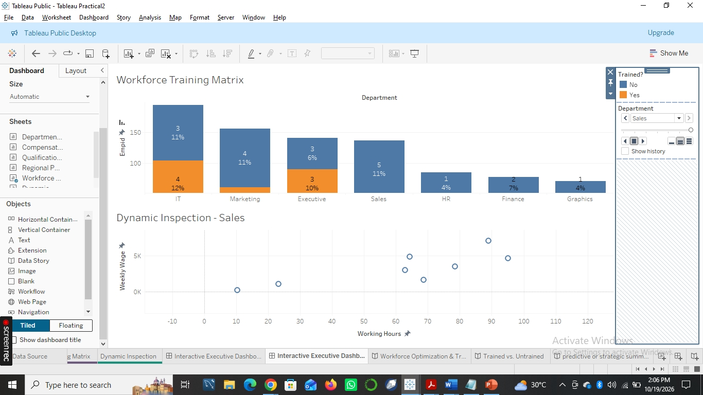
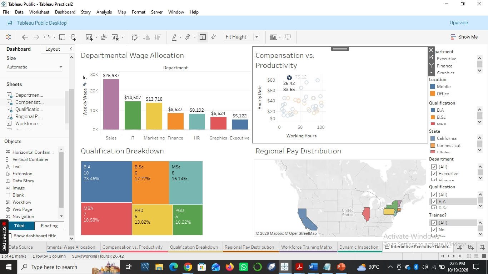

# HR_Workforce_Database
An organized HR database for managing employee records and analyzing workforce data.

## Project Overview
This project is an interactive Tableau dashboard built on an HR workforce database. It helps HR teams and executives see how pay, qualifications, training and working hours are spread across departments and regions.

## What the Dashboard Shows
Departmental Wage Allocation: weekly wages by department
Compensation vs. Productivity: hourly rate against working hours, split by location (Mobile or Office)
Qualification Breakdown: share of staff by qualification (B.A, B.Sc, MSc, MBA, PHD, PGD)
Regional Pay Distribution: a map of pay across US states
Workforce Training Matrix: trained and untrained staff by department
Dynamic Inspection: weekly wage against working hours for a selected department

## Tools Used
Tableau Public Desktop

## Key Insights
Sales has the highest weekly wage allocation (about $25,937), while Executive has the lowest (about $5,122).
B.A holders are the largest qualification group (23.46%), followed by MBA (18.58%) and B.Sc (17.77%).
Trained staff appear only in IT, Marketing and Executive. Sales, HR, Finance and Graphics have no trained staff, which points to a clear training gap.
In the Sales department, weekly wages tend to rise as working hours increase.

## Interactive Features
Filters for department, location, qualification, state and training status let users explore the data from different angles.

## How to View
Download the Tableau workbook (.twb) or the zip file from this repository and open it in Tableau Public Desktop. 
